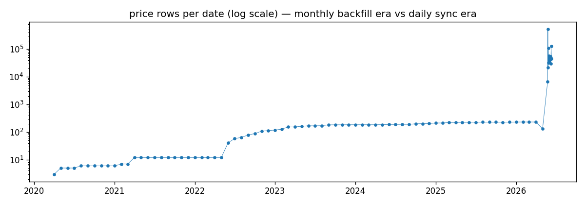
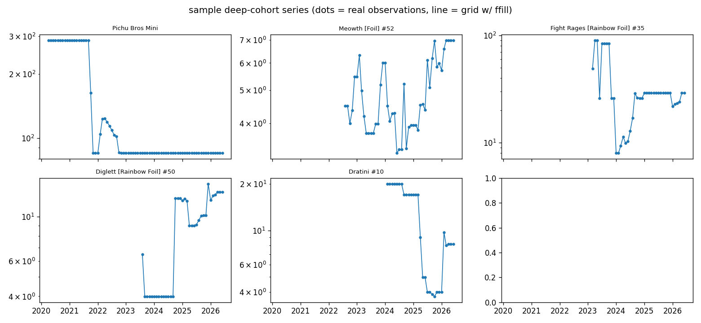

# Data profile

snapshot: `data/raw` | target field: `ungraded_price`

## Regimes

- price rows: 1,361,816 across 599,431 cards
- date range: 2020-04-01 .. 2026-06-10 (92 distinct dates)
- sources: {'pricecharting_api': 1352851, 'apify': 8965}
- deep cohort (apify monthly backfill): 231 cards
- obs/card overall: median 2, p90 4, max 78

## Modeling panel (as configured)

- cards: 168
- grid_rows: 7066
- observed_rows: 7045
- first_period: 2020-04-01
- last_period: 2026-06-01
- obs_per_card_median: 40.0
- obs_per_card_min: 25
- obs_per_card_max: 75

## Price scale (panel cards, median observed price)

- p10 $4.64 | p50 $10.91 | p90 $46.44 | max $1525.00

